<div align="center">

<picture>
  <source media="(prefers-color-scheme: dark)" srcset="docs/media/logo-dark.svg">
  
</picture>

### Finding people with Wi-Fi. No cameras.

ECHO turns the radio signals between ordinary Wi-Fi devices into a live 3D picture of where people are,<br>
and shows exactly how sure it is.

[](https://github.com/keshavkrishnan08/ECHOSPACE/actions/workflows/ci.yml)


[](LICENSE)

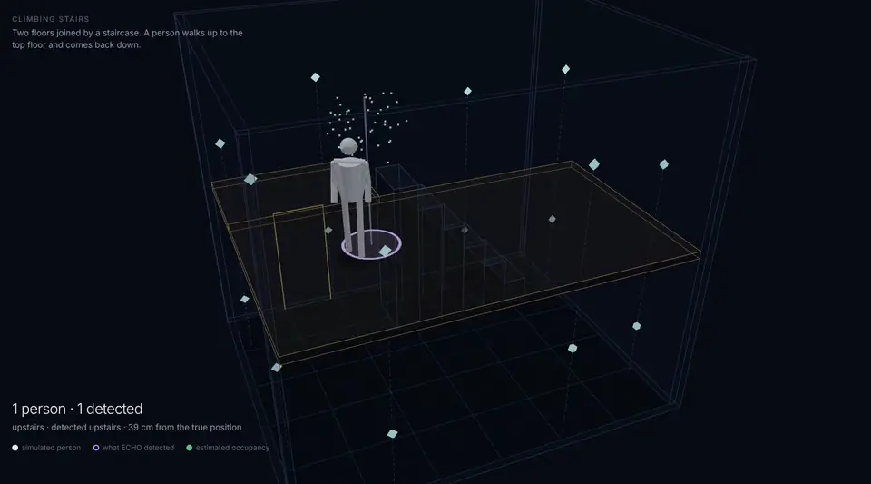

<sub>A person climbs to the upper floor of a two storey building. The violet ring is where ECHO places them using radio signals alone.</sub>

[**Quick start**](#quick-start) · [**How it works**](#how-it-works) · [**Situations**](#situations) · [**Results**](#results) · [**Architecture**](#architecture) · [**Demo videos**](#demo-videos)

</div>

<br>

## Why

When someone moves through a room they disturb the Wi-Fi signal between every pair of devices around them. Measure enough of those disturbances and you can work out where the person is, through walls and in the dark, without a camera ever seeing them.

ECHO is a complete system for that problem: a physically grounded channel simulator, a real time signal pipeline, Bayesian 3D reconstruction, multi person tracking and an evaluation harness that scores every frame against ground truth. It runs entirely in the browser. It also refuses to bluff: space no radio link observes is reported as unknown, models without weights decline to run, and failure cases are shown as clearly as the successes.

## Quick start

```bash
pnpm install
pnpm dev          # http://localhost:3000
```

That is all it needs. The engine runs in a Web Worker, so there is no server, GPU or hardware to set up. The home screen opens on a person walking through a room; pick a situation along the bottom to change it. **Advanced** opens the full research instrument.

<details>
<summary><b>Optional: API, full stack and native library</b></summary>

<br>

```bash
# FastAPI control plane with experiment storage
python -m venv .venv && . .venv/bin/activate
pip install -e ".[api,dev]"
cd services/api && alembic upgrade head && uvicorn echospace_api.main:app --port 8000

# Everything at once: PostgreSQL, MinIO, API and web
docker compose up --build

# C++20 signal processing library and benchmarks
cmake -S engine -B engine/build -DCMAKE_BUILD_TYPE=Release
cmake --build engine/build -j && ctest --test-dir engine/build
```

</details>

## How it works

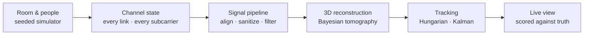

| Stage | What happens |
| --- | --- |
| **Simulate** | A seeded simulator places sensors and moves people along scripted paths, including sitting and climbing stairs. For every link it computes the direct path, first order wall reflections, scatter from six points on each body, Fresnel weighted shadowing and material losses, then adds real radio faults: carrier and timing offsets, gain jumps, packet loss, bursts and jitter. |
| **Clean** | Frames are validated and aligned in time. Phase is sanitized with a linear fit, outliers are removed with a Hampel filter and each link is compared with a baseline learned from the empty room. |
| **Reconstruct** | Bayesian radio tomography, solved in its dual form, turns link changes into a 3D occupancy map. The posterior variance marks space that no link observes, so unknown is never drawn as empty. Coherent back projection and a ridge regression floor model are available for comparison. |
| **Track** | Peaks become detections with a height estimate. The Hungarian algorithm assigns them to tracks, each smoothed by a Kalman filter, and a track only appears after several confirming hits. |
| **Verify** | A Python port of the simulator matches the TypeScript engine bit for bit. A C++20 library reproduces the signal processing. Runs replay deterministically and a SHA-256 digest proves it. |

## Situations

Nine scenes ship with the app, from the easy case to the ones where the system has to admit it cannot tell.

<table>
  <tr>
    <td width="33%">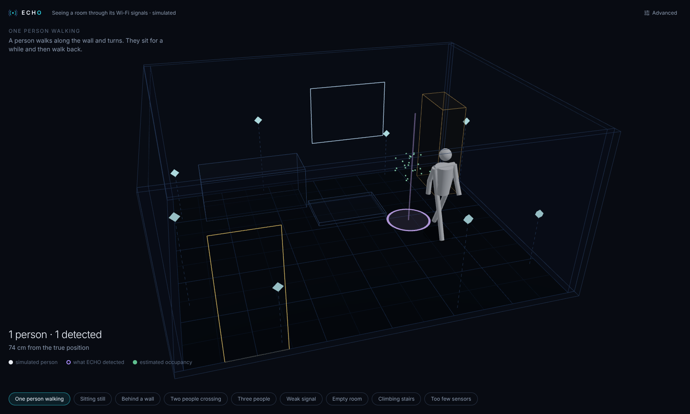<br><b>One person walking</b><br><sub>The ring follows the walker closely.</sub></td>
    <td width="33%">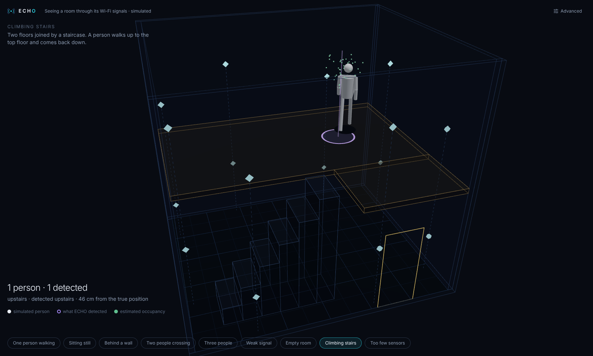<br><b>Climbing stairs</b><br><sub>Two floors. Height is estimated and the floor is named.</sub></td>
    <td width="33%">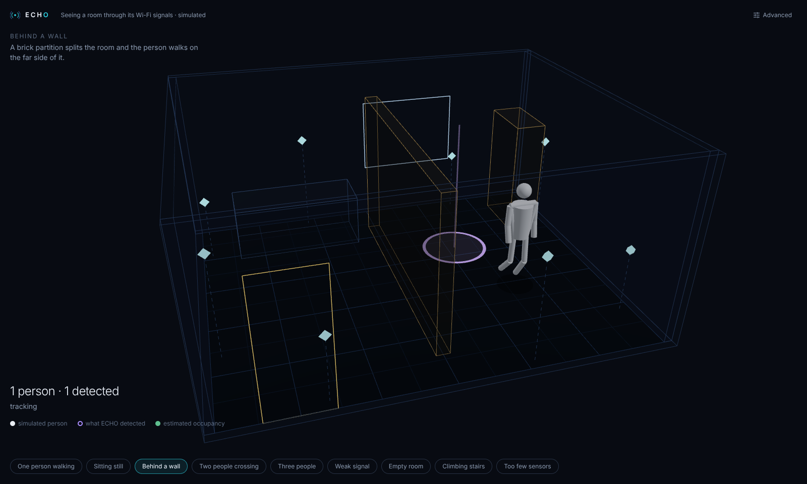<br><b>Behind a wall</b><br><sub>Radio passes through the partition, weakened.</sub></td>
  </tr>
  <tr>
    <td>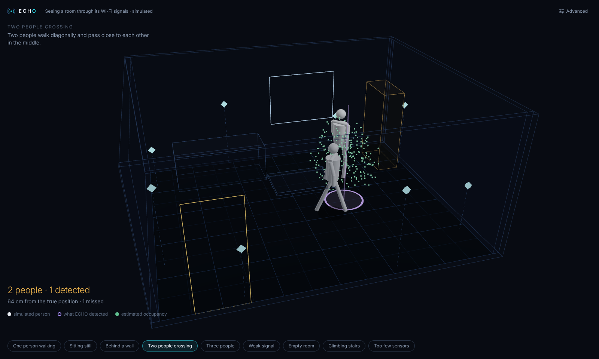<br><b>Two people crossing</b><br><sub>Close together they can merge or swap.</sub></td>
    <td>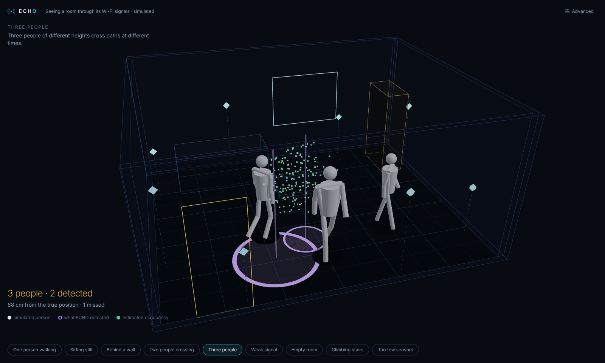<br><b>Three people</b><br><sub>Overlapping signal makes estimates rougher.</sub></td>
    <td>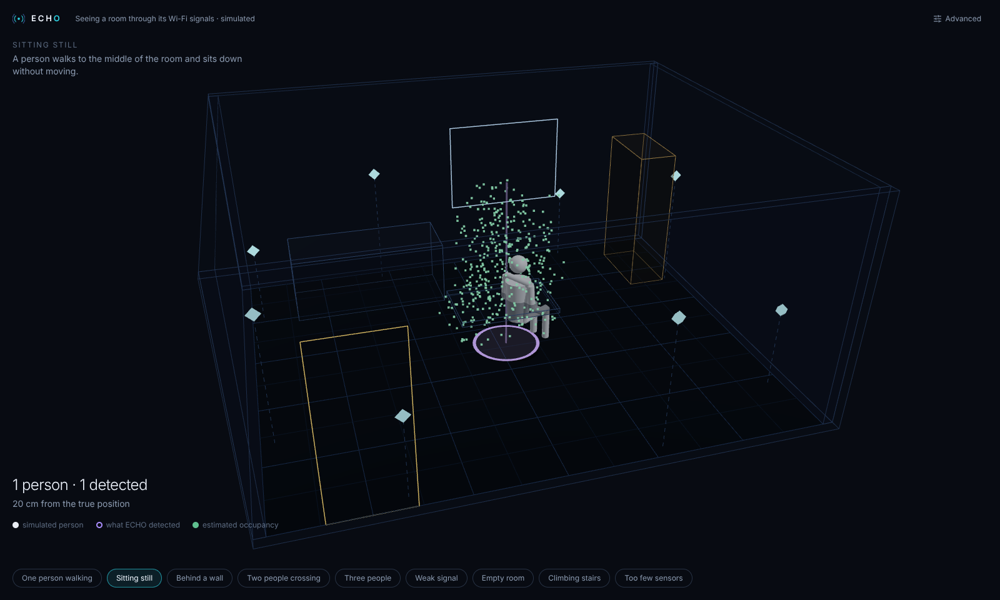<br><b>Sitting still</b><br><sub>A still body barely disturbs the signal.</sub></td>
  </tr>
  <tr>
    <td>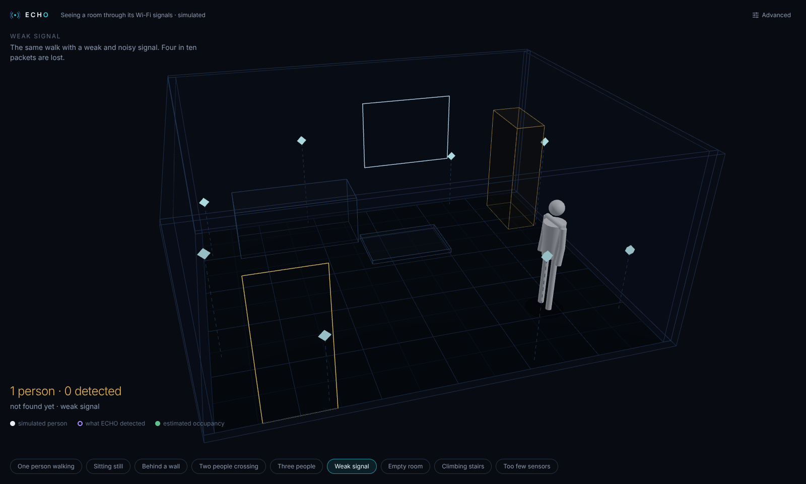<br><b>Weak signal</b><br><sub>Noise and lost packets slow detection.</sub></td>
    <td>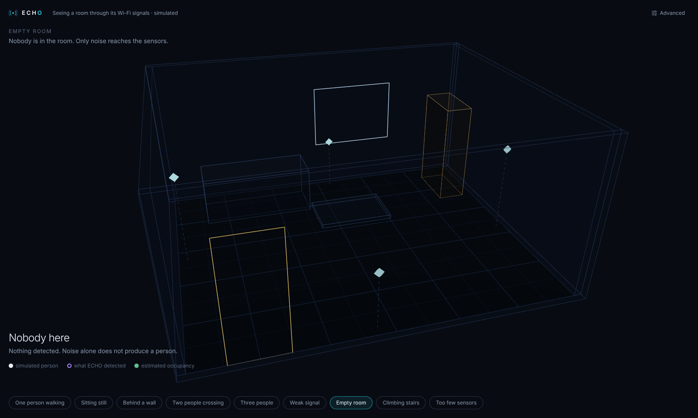<br><b>Empty room</b><br><sub>Noise alone never creates a person.</sub></td>
    <td>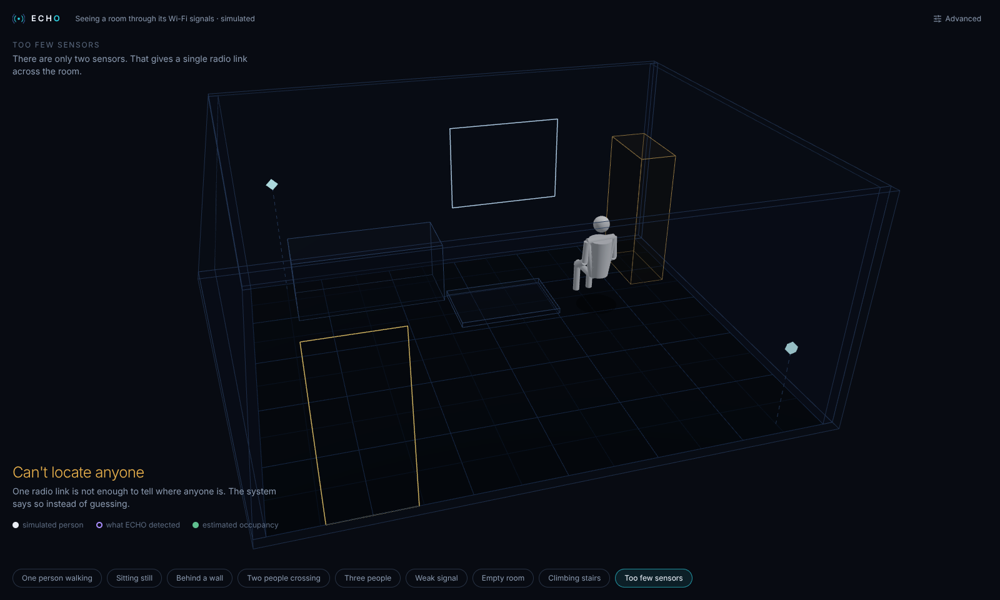<br><b>Too few sensors</b><br><sub>One link cannot locate anyone, so it says so.</sub></td>
  </tr>
</table>

## Results

All numbers below are measured on synthetic scenes from the simulator. They are not field measurements.

**Floor occupancy** on 1,240 held out test frames at 0.5 m cells ([model card](models/model_cards/ridge-floor.md)):

| Model | IoU | Precision | Recall |
| --- | ---: | ---: | ---: |
| Ridge regression floor model | **0.407** | 0.515 | 0.660 |
| Bayesian tomography, threshold tuned on validation | 0.290 | 0.404 | 0.507 |

Neither model marks a single cell in the 318 empty room test frames.

**Two storey tracking**, one person climbing stairs over 75 seconds: the estimated height separates the floors cleanly (about 1.8 to 2.1 m downstairs and 3.4 to 3.8 m upstairs) and floor plan error stays mostly between 10 and 45 cm.

## Architecture

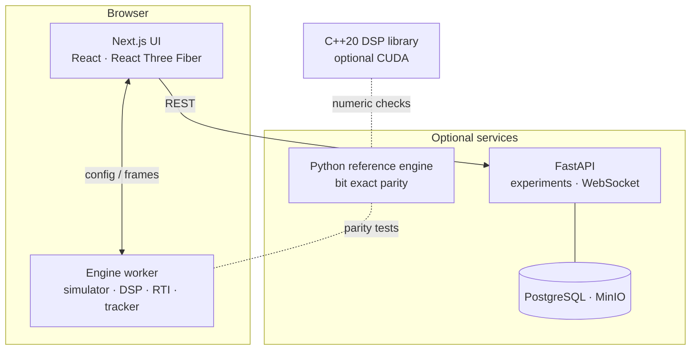

```
apps/web/              Next.js app: the simple view, research instrument and showcase
packages/engine/       TypeScript engine: simulator, DSP, reconstruction, tracking, metrics
packages/schemas/      Zod schemas and the metric catalogue shared by every surface
services/simulator/    Python reference simulator with bit for bit parity
services/inference/    Python reference DSP, reconstruction and tracking
services/api/          FastAPI, SQLAlchemy, Alembic and a WebSocket stream
engine/                C++20 DSP library, CUDA kernels, benchmarks and the gRPC contract
models/                Model registry, model cards, training and evaluation
docs/                  Architecture, simulation model, API, tolerances and privacy
```

## Demo videos

Two short films recorded frame by frame from the app at a steady 30 fps, with subtitles.

| | |
| --- | --- |
| [**One person**](apps/web/public/showcase/demo-1.mp4) · 1:56 | Walking, sitting, a wall and a staircase. |
| [**Harder situations**](apps/web/public/showcase/demo-2.mp4) · 1:20 | Crowds, weak signal, an empty room and too few sensors. |

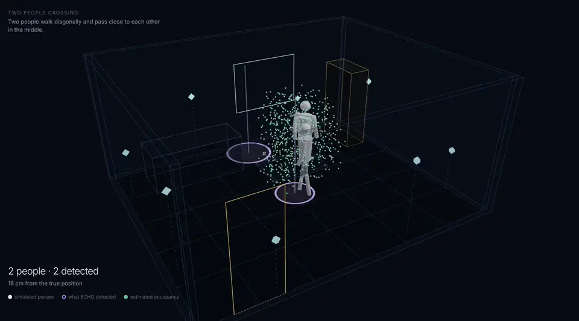

## Testing

| Suite | Command |
| --- | --- |
| Engine: simulator, DSP, reconstruction, pipeline, determinism | `pnpm --filter @echospace/engine test` |
| Python reference, parity, API, migrations, WebSocket | `pytest -q` |
| C++ kernels and ring buffer against NumPy | `ctest --test-dir engine/build && pytest -q engine/tests` |
| End to end in Chromium | `pnpm e2e` |

Every push runs typechecks, linting and all suites in [GitHub Actions](.github/workflows/ci.yml).

## Honest limits

- The channel model is a simplified analytic multipath model, not an electromagnetic solver. See [docs/simulation-model.md](docs/simulation-model.md).
- The ESP32 adapters follow the published CSI format but have not been validated against physical hardware here.
- The CUDA kernels are written but have not been compiled or run. The CPU path is the default.
- No model infers skeletons. The figures in the app are the simulator's ground truth.

## Privacy

Tracks carry random short lived labels and nothing identifies a person. Raw signal recording is off by default, live capture requires stated authorisation and consent, and a coarse mode shows only which parts of a room are occupied. Details in [docs/privacy-and-safety.md](docs/privacy-and-safety.md).

<br>

<div align="center">
<sub>Built by <a href="https://github.com/keshavkrishnan08">Keshav Krishnan</a> · <a href="LICENSE">MIT License</a></sub>
</div>
